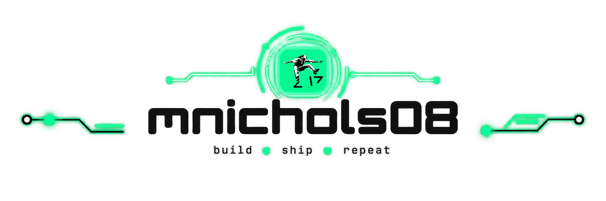

<a href="https://mnix.dev" target="_blank">
<picture>
  <source media="(prefers-color-scheme: dark)" srcset="https://raw.githubusercontent.com/mnichols08/mnichols08/output/banner-dark.png">
  
</picture>
</a>

  <picture>
    <source media="(prefers-color-scheme: dark)" srcset="https://raw.githubusercontent.com/mnichols08/mnichols08/output/typing-dark.svg">
    
  </picture>

 

  <a href="https://mnix.dev">
    <picture>
      <source media="(prefers-color-scheme: dark)" srcset="https://raw.githubusercontent.com/mnichols08/mnichols08/output/badge-portfolio-dark.svg">
      
    </picture>
  </a>
  <a href="https://journeytocode.io">
    <picture>
      <source media="(prefers-color-scheme: dark)" srcset="https://raw.githubusercontent.com/mnichols08/mnichols08/output/badge-writing-dark.svg">
      
    </picture>
  </a>
  
  <a href="https://mnix.dev/file/mnichols-cv.pdf">
    <picture>
      <source media="(prefers-color-scheme: dark)" srcset="https://raw.githubusercontent.com/mnichols08/mnichols08/output/badge-resume-dark.svg">
      
    </picture>
  </a>

---

# Hi, I'm Mikey

I build web applications, from the interface and API to the tests that check how they work together.

I created **[Zubra](https://mnix.dev/projects/zubra)**, an HTML-first compiler for Web Components written in Rust, and I test it on real products: a component library, a 94-game site, a blogging platform's admin studio, and client work at [Potomac Solutions](https://github.com/potomac-solutions). I write about what I learn at **[Journey to Code](https://github.com/journey-to-code-org)**.

Core: **JavaScript · TypeScript · React · Node.js · Web Components · Rust/WebAssembly**

---

# Selected Work

Each title opens a full case study on [mnix.dev](https://mnix.dev).

| Project | What it is | Links |
| --- | --- | --- |
| **[Zubra](https://mnix.dev/projects/zubra)** | A compiler for Web Components. Write a component as HTML with bindings and a script, and get server-rendered HTML plus a small custom element that hydrates it. Rust · WebAssembly · TypeScript | [Demo](https://zubra-js.github.io/zubra/) · [Code](https://github.com/zubra-js/zubra) |
| **[open.parlor](https://mnix.dev/projects/open-parlor)** | A family games site with 94 card, board, word, dice, and arcade games, built to test Zubra where React, Vue, Svelte, Solid, and Angular share one set of components. TypeScript · Zubra · Node.js · PWA | [Demo](https://open-parlor.up.railway.app/) · [Code](https://github.com/journey-to-code-org/open.parlor) |
| **[Zubra UI](https://mnix.dev/projects/zubra-ui)** | 81 accessible web components you copy into your own project and own, for plain HTML or any framework, with a theme studio and page composer. Zubra · Web Components · CSS | [Demo](https://zubra-js.github.io/zubra-ui/) · [Code](https://github.com/zubra-js/zubra-ui) |
| **[open.blog](https://mnix.dev/projects/open-blog)** | A self-hosted blogging platform: Markdown files in, a fast static site out, with feeds, search, themes, scheduling, and a publishing studio built with Zubra UI. Rust · WebAssembly · Web Components | [Demo](https://openblog.journeytocode.io/) · [Code](https://github.com/journey-to-code-org/open.blog) |
| **[Kin](https://mnix.dev/projects/kin)** | A private household app for lists, routines, handoffs, and chat, with on-device encryption and sync a server can relay but never read. Rust · WebAssembly · PWA · SQLite | [Demo](https://kin.journeytocode.io/) · [Code](https://github.com/mnichols08/kin-app) |
| **[Constellation](https://mnix.dev/projects/constellation)** | Turns GitHub activity into interactive project maps and README-ready SVGs. It draws the map further down this page. Rust · Web Components · SVG · GitHub Actions | [Demo](https://mnichols08.github.io/constellation/) · [Code](https://github.com/mnichols08/constellation) |
| **[Readme Studio](https://mnix.dev/projects/readme-studio)** | A browser editor for GitHub profile READMEs with editable sections, live preview, and Markdown import and export. Web Components · WebAssembly · PWA | [Demo](https://readme-studio.journeytocode.io/) · [Code](https://github.com/mnichols08/readme-studio) |

More projects, including earlier work, are on **[mnix.dev](https://mnix.dev/#portfolio)**.

---

# Team & Community Work

Projects I built with other people. Details for each are on my **[team and community page](https://mnix.dev/collaboration)**.

- **[Chingu Voyages](https://mnix.dev/collaboration#chingu)** — five remote, cross-timezone team voyages. I'm currently a developer on [Voyage 63, Tier 3, Team 33](https://github.com/chingu-voyages/V63-tier3-team-33), building an event planner with Next.js, TypeScript, and Supabase. Earlier voyages: [Color Compass](https://mnix.dev/projects/color-compass), [Dinosauria](https://mnix.dev/projects/dinosauria) (lead developer), [Daily Tasks](https://mnix.dev/projects/daily-tasks) (product owner), and [Mad Libs Number 9](https://mnix.dev/projects/mad-libs).
- **[Code the Dream](https://mnix.dev/collaboration#code-the-dream)** — co-project lead, full-stack developer, and testing lead on [Sprout](https://mnix.dev/projects/sprout), a team practicum. Afterwards I grew it into [open.quiz](https://mnix.dev/projects/open-quiz), an open-source learning platform.
- **[Zero To Mastery](https://mnix.dev/collaboration#zero-to-mastery)** — volunteer maintainer of the ZTM Git Gang, and contributor to the [ZTM Desktop App](https://mnix.dev/projects/ztm-desktop-app) (Tauri, React, Rust) and the [ZtM Job Board](https://mnix.dev/projects/ztm-job-board). I submitted four projects to the [ZTM Build Fest](https://github.com/zero-to-mastery/ZTM-Build-Fest).

---

# Technical Writing

I write at **[Journey to Code](https://journeytocode.io)** about what I'm building and learning: JavaScript, Web Components, Git, Rust and WebAssembly, and application architecture.

Featured series

- **[Commit to Success: Mastering Git](https://journeytocode.io/series/learn-git-from-basics-to-advanced)** — Moving beyond basic commands to master version control, branches, merging, and real-world collaboration.
- **[Journey to Web Components](https://journeytocode.io/series/web-components-fundamentals-to-advanced)** — Building reusable UI architecture without heavy frameworks using Custom Elements, Shadow DOM, and native browser APIs.
- **[Mastering the Fetch API & Browser Storage](https://journeytocode.io/series/mastering-fetch-api-browser-storage)** — Network requests, client-side persistence (IndexedDB, Cache API), and resilient offline-first design.
- **[Mastering the Web Audio API](https://journeytocode.io/series/complete-web-audio-api-tutorial)** — Exploring creative coding, spatial audio, synthesis, and processing directly in the browser.
- **[Coding Patterns Demystified](https://journeytocode.io/coding-patterns-demystified)** — A deep dive into the Model-View-Controller pattern with shipping code.

Recent articles

> Automatically synchronized from journeytocode.io via GitHub Actions.

<!-- BLOG-POST-LIST:START -->
- [One Message Is Not a Conversation](https://journeytocode.io/one-message-is-not-a-conversation/) — Keep a Rust TCP client and server talking until quit, using loop, break, continue and the zero-byte read that means the...
- [The Input That Never Got Submitted](https://journeytocode.io/a-custom-input-that-joins-the-form/) — Build a custom form field the browser actually submits, resets and blocks on bad input, using formAssociated and Element...
- [A Server With Nobody to Talk To](https://journeytocode.io/a-server-with-nobody-to-talk-to/) — Build a Rust TCP server and client, send one welcome message across localhost and let Result and the question-mark opera...
- [The File That Exists Twice](https://journeytocode.io/the-file-that-exists-twice/) — Our practicum team never fixed a merge conflict that kept coming back. The cause was one file with two names in Git. See...
- [The Tutorial Is Not the Game.](https://journeytocode.io/the-tutorial-is-not-the-game/) — Turn a finished Rust tutorial into a welcoming open-source project, then take one small contribution from idea to pull r...<!-- BLOG-POST-LIST:END -->

---

# Technical Stack

<strong>Full stack &amp; tooling</strong>

## Systems, Desktop & Hardware

  <picture>
    <source media="(prefers-color-scheme: dark)" srcset="https://img.shields.io/badge/Rust-111111?style=for-the-badge&logo=rust&logoColor=white">
    
  </picture>
  <picture>
    <source media="(prefers-color-scheme: dark)" srcset="https://img.shields.io/badge/WebAssembly-111111?style=for-the-badge&logo=webassembly&logoColor=654FF0">
    
  </picture>
  <picture>
    <source media="(prefers-color-scheme: dark)" srcset="https://raw.githubusercontent.com/mnichols08/mnichols08/output/badge-axum-dark.svg">
    
  </picture>
  <picture>
    <source media="(prefers-color-scheme: dark)" srcset="https://img.shields.io/badge/Tauri-111111?style=for-the-badge&logo=tauri&logoColor=24C8D8">
    
  </picture>
  <picture>
    <source media="(prefers-color-scheme: dark)" srcset="https://img.shields.io/badge/Electron-111111?style=for-the-badge&logo=electron&logoColor=9FEAF9">
    
  </picture>
  <picture>
    <source media="(prefers-color-scheme: dark)" srcset="https://img.shields.io/badge/Raspberry_Pi-111111?style=for-the-badge&logo=raspberrypi&logoColor=C51A4A">
    
  </picture>

## Frontend

  
  <picture>
    <source media="(prefers-color-scheme: dark)" srcset="https://img.shields.io/badge/React-111111?style=for-the-badge&logo=react&logoColor=61DAFB">
    
  </picture>
  <picture>
    <source media="(prefers-color-scheme: dark)" srcset="https://img.shields.io/badge/Next.js-111111?style=for-the-badge&logo=nextdotjs&logoColor=white">
    
  </picture>
  <picture>
    <source media="(prefers-color-scheme: dark)" srcset="https://raw.githubusercontent.com/mnichols08/mnichols08/output/badge-webcomponents-dark.svg">
    
  </picture>
  <picture>
    <source media="(prefers-color-scheme: dark)" srcset="https://img.shields.io/badge/HTML5-111111?style=for-the-badge&logo=html5&logoColor=E34F26">
    
  </picture>
  <picture>
    <source media="(prefers-color-scheme: dark)" srcset="https://img.shields.io/badge/CSS3-111111?style=for-the-badge&logo=css&logoColor=1572B6">
    
  </picture>

## Backend & APIs

  <picture>
    <source media="(prefers-color-scheme: dark)" srcset="https://img.shields.io/badge/Node.js-111111?style=for-the-badge&logo=nodedotjs&logoColor=5FA04E">
    
  </picture>
  <picture>
    <source media="(prefers-color-scheme: dark)" srcset="https://img.shields.io/badge/Express-111111?style=for-the-badge&logo=express&logoColor=white">
    
  </picture>
  <picture>
    <source media="(prefers-color-scheme: dark)" srcset="https://raw.githubusercontent.com/mnichols08/mnichols08/output/badge-restapis-dark.svg">
    
  </picture>
  <picture>
    <source media="(prefers-color-scheme: dark)" srcset="https://img.shields.io/badge/MongoDB-111111?style=for-the-badge&logo=mongodb&logoColor=47A248">
    
  </picture>
  <picture>
    <source media="(prefers-color-scheme: dark)" srcset="https://img.shields.io/badge/PostgreSQL-111111?style=for-the-badge&logo=postgresql&logoColor=4169E1">
    
  </picture>
  <picture>
    <source media="(prefers-color-scheme: dark)" srcset="https://img.shields.io/badge/Airtable-111111?style=for-the-badge&logo=airtable&logoColor=18BFFF">
    
  </picture>

## Testing & Quality

  <picture>
    <source media="(prefers-color-scheme: dark)" srcset="https://img.shields.io/badge/TypeScript-111111?style=for-the-badge&logo=typescript&logoColor=3178C6">
    
  </picture>
  <picture>
    <source media="(prefers-color-scheme: dark)" srcset="https://img.shields.io/badge/Vitest-111111?style=for-the-badge&logo=vitest&logoColor=6E9F18">
    
  </picture>
  <picture>
    <source media="(prefers-color-scheme: dark)" srcset="https://img.shields.io/badge/Jest-111111?style=for-the-badge&logo=jest&logoColor=C21325">
    
  </picture>
  <picture>
    <source media="(prefers-color-scheme: dark)" srcset="https://img.shields.io/badge/React_Testing_Library-111111?style=for-the-badge&logo=testinglibrary&logoColor=E33332">
    
  </picture>
  <picture>
    <source media="(prefers-color-scheme: dark)" srcset="https://img.shields.io/badge/Playwright-111111?style=for-the-badge&logo=playwright&logoColor=45BA4B">
    
  </picture>
  <picture>
    <source media="(prefers-color-scheme: dark)" srcset="https://img.shields.io/badge/ESLint-111111?style=for-the-badge&logo=eslint&logoColor=4B32C3">
    
  </picture>
  <picture>
    <source media="(prefers-color-scheme: dark)" srcset="https://img.shields.io/badge/Prettier-111111?style=for-the-badge&logo=prettier&logoColor=F7B93E">
    
  </picture>

## Workflow & Deployment

  <picture>
    <source media="(prefers-color-scheme: dark)" srcset="https://img.shields.io/badge/Git-111111?style=for-the-badge&logo=git&logoColor=F05032">
    
  </picture>
  <picture>
    <source media="(prefers-color-scheme: dark)" srcset="https://img.shields.io/badge/GitHub-111111?style=for-the-badge&logo=github&logoColor=white">
    
  </picture>
  <picture>
    <source media="(prefers-color-scheme: dark)" srcset="https://img.shields.io/badge/GitHub_Actions-111111?style=for-the-badge&logo=githubactions&logoColor=2088FF">
    
  </picture>
  <picture>
    <source media="(prefers-color-scheme: dark)" srcset="https://img.shields.io/badge/Vite-111111?style=for-the-badge&logo=vite&logoColor=646CFF">
    
  </picture>
  <picture>
    <source media="(prefers-color-scheme: dark)" srcset="https://img.shields.io/badge/Postman-111111?style=for-the-badge&logo=postman&logoColor=FF6C37">
    
  </picture>
  <picture>
    <source media="(prefers-color-scheme: dark)" srcset="https://img.shields.io/badge/Netlify-111111?style=for-the-badge&logo=netlify&logoColor=00C7B7">
    
  </picture>
  <picture>
    <source media="(prefers-color-scheme: dark)" srcset="https://img.shields.io/badge/Render-111111?style=for-the-badge&logo=render&logoColor=white">
    
  </picture>

<strong>Tech stack</strong>

  

  

Declared in each repository's manifests, redrawn daily with a different slight motion. It shows what is used and when, not how well.

---

<strong>GitHub activity &amp; project constellation</strong>

  <picture>
    <source media="(prefers-color-scheme: dark)" srcset="https://raw.githubusercontent.com/mnichols08/mnichols08/output/streak-dark.svg">
    
  </picture>

  <picture>
    <source media="(prefers-color-scheme: dark)" srcset="https://raw.githubusercontent.com/mnichols08/mnichols08/output/metrics-dark.svg">
    
  </picture>

  <picture>
    <source media="(prefers-color-scheme: dark)" srcset="https://raw.githubusercontent.com/mnichols08/mnichols08/output/metrics.isocalendar-dark.svg">
    
  </picture>

A new sky every day: palette, layout and motion are redrawn from my repositories.

---

# Let's Talk

I'm open to remote full-stack and frontend roles, project ideas, and collaborations, especially where **performance, offline-first design, and framework-agnostic UI** matter.

**[Portfolio](https://mnix.dev)** · **[Journey to Code](https://journeytocode.io)** · **[LinkedIn](https://linkedin.com/in/mnix-dev)** · **[Resume](https://mnix.dev/file/mnichols-cv.pdf)**

 

Please don't mind me, just feeding my snake down here...

<picture width="100%">
  <source media="(prefers-color-scheme: dark)" srcset="https://raw.githubusercontent.com/mnichols08/mnichols08/output/github-snake-dark.svg">
  <source media="(prefers-color-scheme: light)" srcset="https://raw.githubusercontent.com/mnichols08/mnichols08/output/github-snake.svg">
  
</picture>

